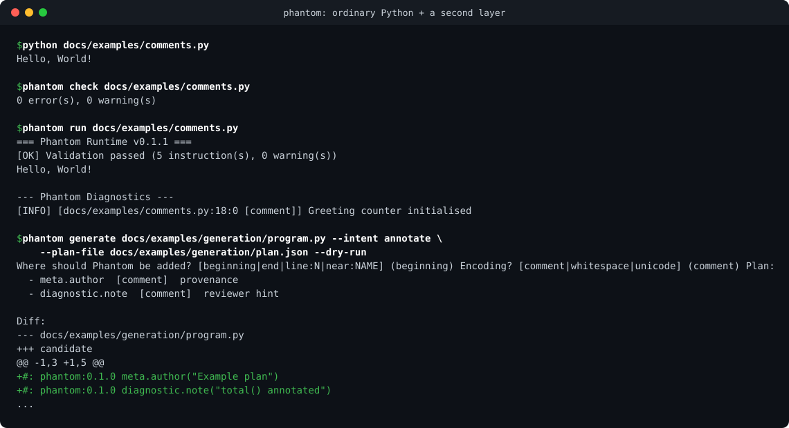

# Phantom

🌐 **Translations:** [हिन्दी](docs/hi/README.md) · [Deutsch](docs/de/QUICKSTART.md) · [Español](docs/es/QUICKSTART.md)

[](https://github.com/hayagrivai-labs/phantom/actions/workflows/tests.yml)
[](https://github.com/hayagrivai-labs/phantom/releases)
[](LICENSE)
[](docs/COMPATIBILITY.md)
[](https://github.com/hayagrivai-labs/phantom/issues?q=is%3Aissue+is%3Aopen+label%3A%22good+first+issue%22)
[](https://github.com/hayagrivai-labs/phantom/issues?q=is%3Aissue+is%3Aopen+label%3A%22first-timers-only%22)
[](CONTRIBUTING.md)
[](https://github.com/hayagrivai-labs/phantom/discussions)

> **Contributors welcome.** New here? Pick a [good first issue](https://github.com/hayagrivai-labs/phantom/issues?q=is%3Aissue+is%3Aopen+label%3A%22good+first+issue%22), read the [Contributor Guide](docs/CONTRIBUTOR_GUIDE.md), and say hello in [Discussions](https://github.com/hayagrivai-labs/phantom/discussions). Adding a new instruction takes four code edits. Issues labelled `mentor available` come with maintainer help. [Open in a Codespace](https://codespaces.new/hayagrivai-labs/phantom) for a ready-to-go environment.

**Phantom** is a dual-layer programming concept: ordinary Python source plus a second, structured *instruction layer* embedded in comments (or in whitespace / zero-width blocks), with no Phantom imports, decorators or wrappers in your code.

> Version **0.1.1** — an early release. Small, tested, and honest about what it does not do (see [Limitations](#current-limitations)).

<p align="center">
  
</p>

## Why

Real Python code gets cluttered with scaffolding that isn't the business logic: metrics calls, lifecycle hooks, provenance notes, decorators, `import` lines for tooling. Phantom tries a different split. Your file stays ordinary Python. The scaffolding lives in a **second, typed, validated layer** next to it, which tools (and people) can read, check and apply, and which an LLM can propose **as a diff, never as a rewrite**.

- **Your code is untouched.** `python app.py` runs it exactly as before. Phantom never edits it.
- **The second layer is inspectable.** A formal grammar, `phantom check`, `phantom inspect`, and a strict audit for invisible characters.
- **AI changes are verifiable.** `phantom generate` only inserts lines, and accepts a candidate only if the Python AST is identical to the original.
- **Small and honest.** Seven instructions, no runtime dependencies, features labelled *Implemented / Experimental / Proposed*.

## Try it in 30 seconds

```bash
pip install "git+https://github.com/hayagrivai-labs/phantom.git"
printf 'print("Hello")\n#: phantom:0.1.0 diagnostic.note("it works")\n' > hello.py
phantom run hello.py
```

You should see `Hello` followed by a Phantom diagnostic `it works`. (Not on PyPI yet; see [docs/RELEASING.md](docs/RELEASING.md).)

If Phantom looks useful or interesting, a star helps other people find it. If you want to shape it, the [good first issues](https://github.com/hayagrivai-labs/phantom/issues?q=is%3Aissue+is%3Aopen+label%3A%22good+first+issue%22) are the best way in.

## What it is

```python
def process_payment(amount: float) -> bool:
    return amount > 0

#: phantom:0.1.0 meta.author("Payments team")
#: phantom:0.1.0 counter.create("payments", 1000)
#: phantom:0.1.0 diagnostic.note("Payment module annotated")
```

- `python app.py` runs your code; Phantom lines are comments and are **not** executed by stock Python.
- `phantom run app.py` parses and validates the instruction layer, applies it, then runs your unmodified file as a subprocess.

Phantom does not modify Python, install import hooks, or change your environment. The execution model is spelled out in [docs/RUNTIME.md](docs/RUNTIME.md).

## Features

- Eight instructions: events, bounded counters, diagnostic notes, author/license/version metadata ([reference](docs/LANGUAGE_GUIDE.md)).
- A formal grammar ([SPECIFICATION.md](SPECIFICATION.md)) and a typed, immutable IR.
- Four encodings: **comment** (recommended), whitespace, zero-width Unicode, hybrid ([ENCODINGS.md](docs/ENCODINGS.md)).
- Static validation with line/column diagnostics and SARIF export.
- Strict audit for invisible and bidirectional characters (`--strict`).
- Lifecycle events with plain-function handlers; per-instruction capabilities.
- Optional LLM-assisted generator that proposes a *separate candidate file* and checks it ([GENERATOR.md](docs/GENERATOR.md)).
- No runtime dependencies. No network use unless you run `generate` and consent.

## Install

Python ≥ 3.10.

```bash
pip install .                 # core
pip install -e ".[dev]"       # development (pytest, ruff)
pip install -e ".[llm]"       # optional: google-genai for `phantom generate`
```

See [docs/INSTALLATION.md](docs/INSTALLATION.md).

## Quick start

```bash
phantom check   docs/examples/comments.py     # validate, run nothing
phantom inspect docs/examples/comments.py     # show decoded instructions
phantom run     docs/examples/comments.py     # apply instructions, run the host
```

```text
=== Phantom Runtime v0.1.1 ===
[OK] Validation passed (5 instruction(s), 0 warning(s))
Hello, World!

--- Phantom Diagnostics ---
[INFO] [docs/examples/comments.py:18:0 [comment]] Greeting counter initialised
```

Walkthrough: [docs/QUICKSTART.md](docs/QUICKSTART.md).

## Commands

| Command | Purpose | Executes your code? |
| :--- | :--- | :--- |
| `phantom check FILE [--strict] [--format sarif] [--deny CAP] [--allow-only CAP]` | Validate (optionally against a capability policy); exit 2 on errors | No |
| `phantom inspect FILE [--json] [--strict] [--deny CAP] [--allow-only CAP]` | Show recognised instructions, locations, capabilities (and which a policy blocks) and any parse errors; exit 2 on parse errors or `--strict` findings | No |
| `phantom run FILE [--timeout SEC] [--deny CAP] [--allow-only CAP] [--handlers-from DIR] [--allow-handler PATTERN] [-- ARGS]` | Validate, apply, run the host; exits with the host's status | **Yes** |
| `phantom generate FILE --intent TEXT [--placement …] [--encoding …] [--output …] [--dry-run] [--allow-remote]` | Propose a candidate with Phantom instructions | No (sends source to the provider) |
| `phantom diff ORIGINAL CANDIDATE` | Unified diff | No |
| `phantom verify ORIGINAL CANDIDATE` | Run both and compare stdout/stderr/exit code | **Yes** (both) |

`python -m phantom …` is equivalent to `phantom …`.

## Instructions

| Instruction | Effect |
| :--- | :--- |
| `event.declare(name)` | declare an event |
| `event.on(event, handler)` | register `"module.function"` for a declared event |
| `diagnostic.note(message)` | record a located note |
| `counter.create(name, limit)` | bounded counter (`limit > 0`) |
| `counter.increment(name)` | add 1 (logs an error diagnostic past the limit) |
| `meta.author(name)` / `meta.version(version)` | provenance metadata |

Instruction effects are applied **at initialisation, before the host starts**, not when execution reaches the line. Only the lifecycle events `phantom.pre_execute`, `phantom.post_execute` and `phantom.shutdown` are fired.

## LLM generator

`phantom generate` asks a model for a JSON plan from the real instruction registry, validates it, inserts the instructions as new lines at a location it resolves itself, and checks that the result is valid Python, valid Phantom, and has an **identical Python AST** to your original. It never overwrites your file and never runs the candidate. Using the Gemini provider sends your source to Google's service; this requires `--allow-remote`. The provider integration has not been run against the live API in this repository. Details and limits: [docs/GENERATOR.md](docs/GENERATOR.md).

## Security notes

- Parsing, `check`, `inspect`, `diff` never execute or rewrite your files (covered by tests).
- Instruction arguments are literals; nothing decoded is passed to `eval`/`exec`/a shell.
- **`phantom run` executes the file, and handler paths import modules** — only run files you trust. There is no sandbox.
- Whitespace / zero-width encodings are not secret or secure; `--strict` exists to surface them.

See [SECURITY.md](SECURITY.md) and [docs/THREAT_MODEL.md](docs/THREAT_MODEL.md).

## Current limitations

- Python hosts only; instructions cannot hook into host control flow.
- Custom events can be declared but not fired from host code.
- Whitespace and zero-width encodings are fragile under formatters and normalisation.
- `verify` compares one run; it is not a proof of equivalence.
- CI has passed on Python 3.10–3.13 on Ubuntu and Windows; macOS is untested.
- **Phantom C** (a dual-layer model for compiled languages and a study of observer visibility) is a long-term **research vision**, not implemented: [docs/research/PHANTOM_C.md](docs/research/PHANTOM_C.md). Status of every feature: [docs/RESEARCH_STATUS.md](docs/RESEARCH_STATUS.md).

## Tests

```bash
pytest                                   # full suite
pytest --cov=phantom --cov-report=term-missing
ruff check src tests scripts
python scripts/verify_release.py         # release consistency gates
```

## Contributing

Contributions of every size are welcome: bug fixes, tests, docs, new instructions, encodings, LLM providers and research experiments. Start with [CONTRIBUTING.md](CONTRIBUTING.md) and the step-by-step [Contributor Guide](docs/CONTRIBUTOR_GUIDE.md) (adding an instruction takes four code edits). Ideas are tracked as GitHub issues labelled `good first issue`, `help wanted`, `mentor available` and `needs design`. Before a pull request run `ruff check src tests scripts`, `pytest` and `python scripts/verify_release.py`. Questions and ideas are welcome in [Discussions](https://github.com/hayagrivai-labs/phantom/discussions); maintainers are listed in [MAINTAINERS.md](MAINTAINERS.md) and design decisions in [docs/adr/](docs/adr/).

### Contributors

<a href="https://github.com/hayagrivai-labs/phantom/graphs/contributors"></a>

Everyone who has a pull request merged is thanked in the release notes.

## Documentation

[SPECIFICATION](SPECIFICATION.md) · [VISION](VISION.md) · [ROADMAP](ROADMAP.md) · [CHANGELOG](CHANGELOG.md) · [SECURITY](SECURITY.md) · [CONTRIBUTING](CONTRIBUTING.md)

Guides: [Contributor guide](docs/CONTRIBUTOR_GUIDE.md) · [Installation](docs/INSTALLATION.md) · [CI](docs/CI.md) · [Quickstart](docs/QUICKSTART.md) · [Language](docs/LANGUAGE_GUIDE.md) · [Encodings](docs/ENCODINGS.md) · [Runtime](docs/RUNTIME.md) · [Generator](docs/GENERATOR.md) · [Architecture](docs/ARCHITECTURE.md) · [Compatibility](docs/COMPATIBILITY.md) · [Troubleshooting](docs/TROUBLESHOOTING.md) · [FAQ](docs/FAQ.md) · [Threat model](docs/THREAT_MODEL.md) · [Research status](docs/RESEARCH_STATUS.md)

Research: [overview](docs/research/README.md) · [Phantom C](docs/research/PHANTOM_C.md) · [Observability](docs/research/OBSERVABILITY.md) · [Method](docs/research/EXPERIMENTAL_METHOD.md)

## License

MIT — see [LICENSE](LICENSE).
